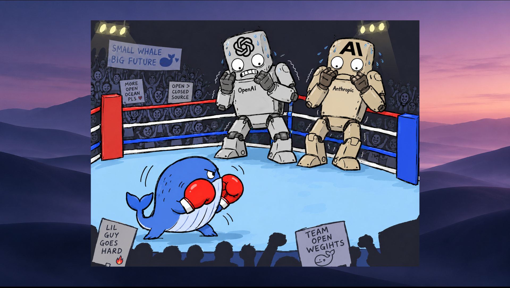
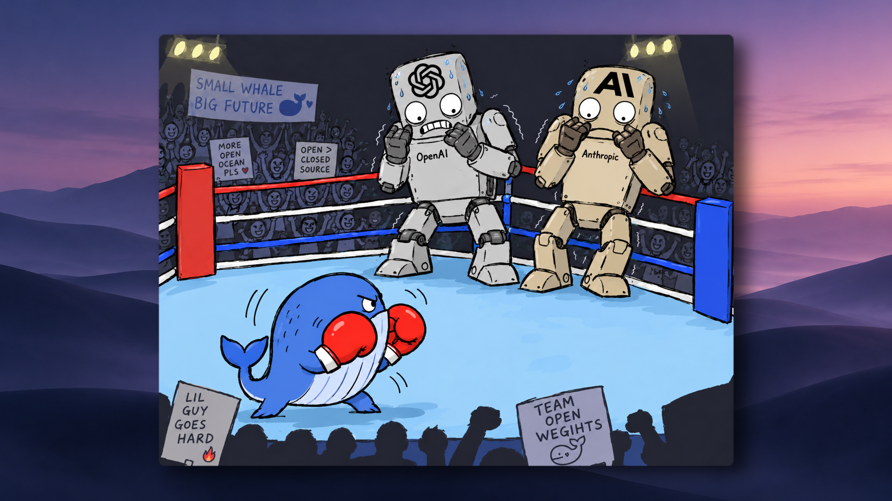

# Kintu DaVinci Resolve

I'll be adding custom effects and plugins here for things I wish DaVinci Resolve made drag-and-drop simple.

## Rounded Image + Shadow

A quick way to give images and videos rounded corners and a drop shadow, across different dimensions and aspect ratios.

**Without the effect**

**With Rounded Image + Shadow**

## Install

1. [Download Kintu-Effects.drfx](https://github.com/gkintu/kintu-davinci-resolve/releases/latest/download/Kintu-Effects.drfx).
2. Double-click the file and confirm installation in Resolve.
3. Restart Resolve if the effect does not appear.

## Use

Find **Rounded Image + Shadow** under **Effects > Fusion Effects > Kintu** and drag it onto a clip. Adjust the corners and shadow in **Inspector > Effects**.

For sharp zooms, keep **Card Scale at 1.0** and use **Inspector > Video > Transform > Zoom**. Enlargement is still limited by the source resolution.

When updating, remove and re-add the effect on existing clips to load the new version.

Tested on Windows with Resolve Studio 21.1, at 1920x1080 and 2560x1440, using landscape, portrait, and square media.

The editable effect is in [`effects/`](effects/).
